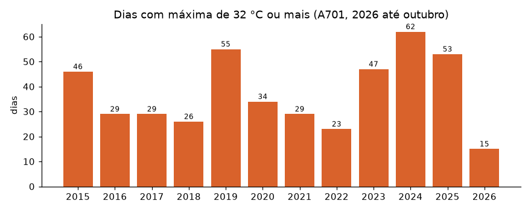
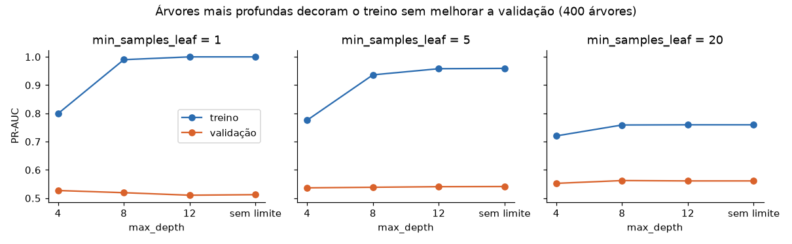
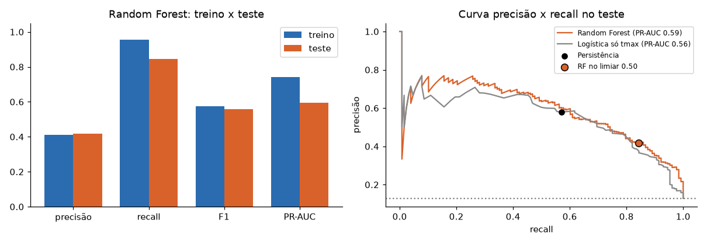

# Relatório de ML: previsão de dia de calor perigoso

**Sombra Amiga**, Global Solution 2026.2, FIAP. Integrantes: Glauco Heitor Gonçalves (RM 555978) e Pedro Henrique Junqueira (RM 556278).

Notebook executado: [previsao_calor.ipynb](previsao_calor.ipynb)

## 1. Problema

Idosos e trabalhadores de rua são os mais afetados pelo calor extremo em São Paulo, e o aviso costuma chegar quando o calor já começou. O Sombra Amiga quer avisar **na véspera**.

**Pergunta de ML:** com os dados meteorológicos de hoje, conseguimos prever se amanhã a máxima vai chegar a 32 °C ou mais?

É uma classificação binária. O limite de 32 °C é critério da equipe e coincide com o início da faixa "alto" de risco usada na API.

## 2. Dados reais

| Item | Valor |
|---|---|
| Fonte | INMET, estações automáticas: https://portal.inmet.gov.br/dadoshistoricos |
| Estação | A701, São Paulo, Mirante de Santana |
| Período | 01/01/2015 a 31/10/2026, uma leitura por hora (103.728 leituras) |
| Qualidade | Cobertura acima de 97% em todos os anos. 4.293 dias com pelo menos 20 horas de leitura |

Os dias de 32 °C ou mais aumentaram nos últimos anos: foram 23 em 2022, 47 em 2023, 62 em 2024 e 53 em 2025.

## 3. Preparação e divisão

- **Carregamento:** os arquivos mudam de formato entre os anos, nas datas, nas horas e na marcação de dado ausente. A hora vem em UTC e foi convertida para o horário local, o que mudou a que dia cada leitura pertence. O pico de temperatura entre 14h e 15h confirma a conversão.
- **Variáveis (17):** medidas do dia (máxima, mínima, média, umidade, chuva, pressão, vento, radiação e índice de calor), memória recente (máximas de ontem e anteontem, médias de 3 e 7 dias, variação da pressão) e época do ano (seno e cosseno). Todas usam só informação disponível até a noite de hoje.
- **Divisão temporal:** treino de 2015 a 2023 (3.181 dias, 9,7% quentes) e teste de 2024 a outubro de 2026 (998 dias, 12,8% quentes). Uma divisão aleatória misturaria dias vizinhos entre treino e teste e inflaria o resultado.

## 4. Modelo

Escolhemos **Random Forest** porque ele capta relações não lineares entre as variáveis, funciona bem com alguns milhares de exemplos, mostra a importância de cada variável e lida com classes desbalanceadas por meio de `class_weight="balanced"`.

As referências de comparação são:
- **Persistência:** "amanhã será como hoje".
- **Regressão logística** usando só a máxima de hoje.

## 5. Treino com diferentes hiperparâmetros

Testamos 24 combinações de `n_estimators` (200 e 400), `max_depth` (4, 8, 12 e sem limite) e `min_samples_leaf` (1, 5 e 20). A validação cruzada usou `TimeSeriesSplit` com 5 dobras, **apenas no treino**, e a métrica de escolha foi a PR-AUC.

A melhor combinação foi `max_depth=12`, `min_samples_leaf=20` e `n_estimators=200`. O limiar de decisão, 0,50, foi escolhido para maximizar o F2, que valoriza o recall, usando as previsões de validação do próprio treino.

## 6. Resultados em treino e teste

| | Precisão | Recall | F1 | PR-AUC |
|---|---|---|---|---|
| Random Forest, treino | 0,41 | 0,96 | 0,58 | 0,74 |
| **Random Forest, teste** | **0,42** | **0,84** | **0,56** | **0,60** |
| Persistência, teste | 0,58 | 0,57 | 0,58 | - |
| Logística só com a máxima, teste | 0,36 | 0,86 | 0,51 | 0,56 |

- **Overfitting:** sem restrição nas folhas, a PR-AUC de treino chega a 1,00, e a de validação fica em 0,51. Exigir 20 exemplos por folha reduziu o treino para 0,76 e melhorou a validação para 0,57. Ainda resta uma diferença entre treino (0,74) e teste (0,60): o recall cai de 0,96 para 0,84, enquanto a precisão se mantém.
- **Comparação honesta:** o modelo avisa muito mais dias quentes do que a persistência (84% contra 57%), mas gera 150 alarmes falsos em 998 dias. No F1, os dois empatam. O ganho está em poder ajustar o equilíbrio pelo limiar e em prever **viradas**: dos 55 dias quentes que vieram depois de um dia ameno, o modelo avisou 35, e a persistência nenhum.
- **Mudança de período:** o teste é mais quente do que o treino. A PR-AUC do teste, um pouco acima da validação, reflete esse aumento de dias quentes e não uma melhora do modelo. Em 2026, os dados vão só até outubro, com apenas 15 dias quentes, e a precisão cai para 0,26.

## 7. Conclusão para o cidadão

De cada 100 dias de calor perigoso, o modelo avisaria na véspera cerca de 84. A regra "amanhã será como hoje" avisaria 57. O custo é que cerca de 6 em cada 10 alertas não se confirmam.

Para um idoso, um alarme falso significa beber mais água e evitar o sol, enquanto um dia perigoso sem aviso pode terminar em internação. Por isso, o Sombra Amiga usa a previsão como **aviso de preparação na véspera**, e os sensores confirmam o risco no próprio dia. A previsão entra na API pela rota `POST /api/alertas/previsao`.

**Limitações:**
- Uma única estação representa a cidade inteira.
- O modelo não usa previsão numérica do tempo, então complementa os avisos oficiais e não os substitui.
- O limite de 32 °C não tem validação clínica.
