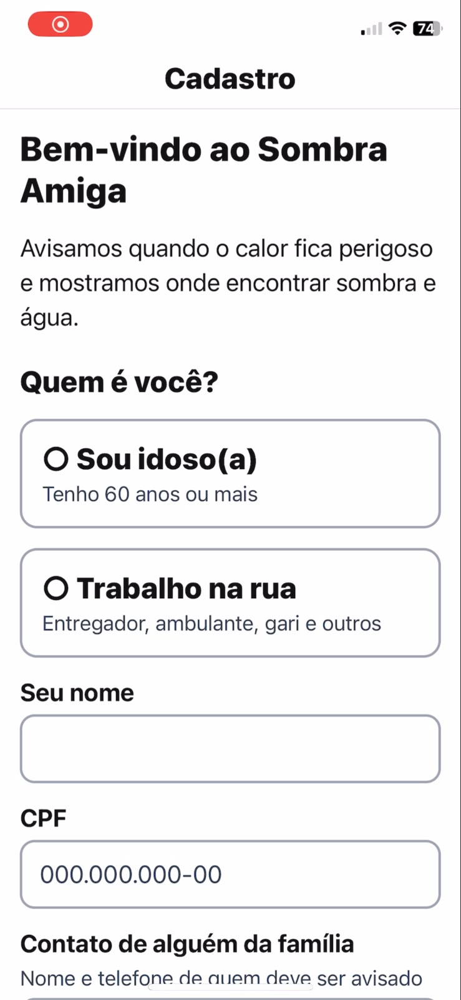
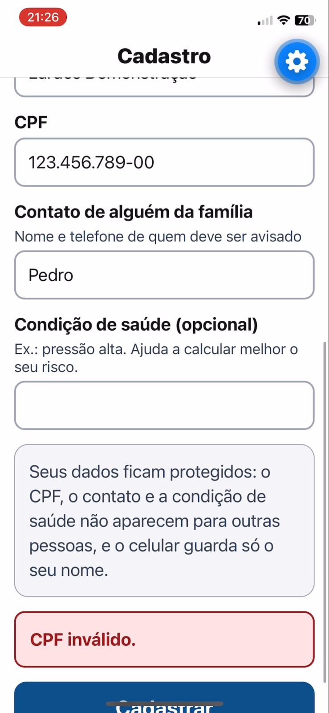
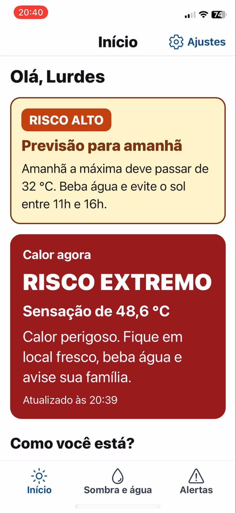
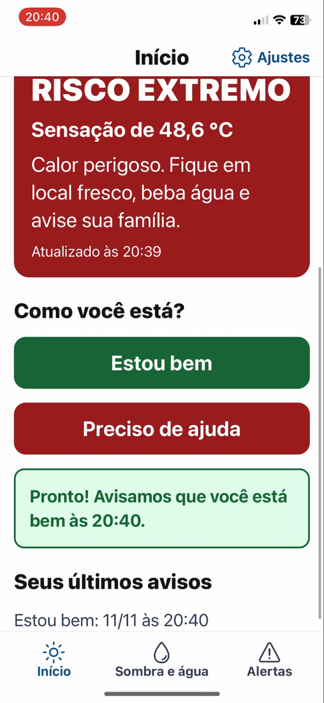
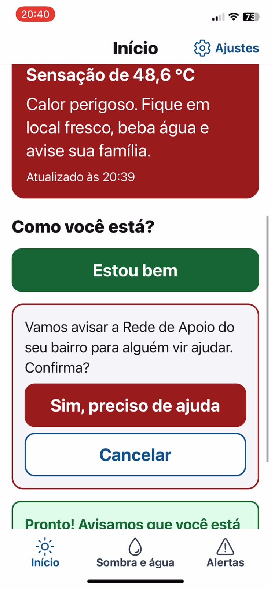
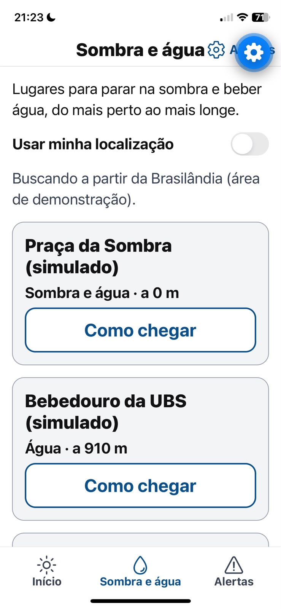
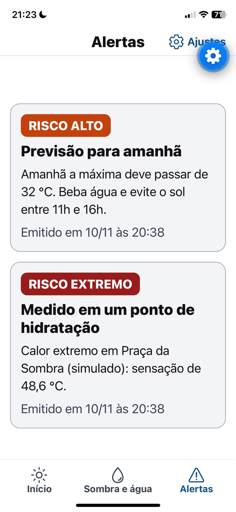
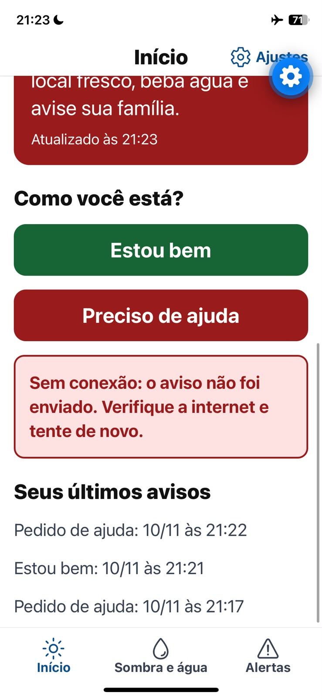

# App Sombra Amiga (Expo / React Native)

App do cidadão da CitizenTech **Sombra Amiga**, disciplina **Mobile Development & IOT**.

**Integrantes:** Glauco Heitor Gonçalves (RM 555978) e Pedro Henrique Junqueira (RM 556278).

## Ficha da CitizenTech

| Campo | Conteúdo |
|---|---|
| **Nome** | Sombra Amiga |
| **Cidade e bairro** | São Paulo, Brasilândia (zona norte) |
| **Cidadão beneficiado** | Idosos e trabalhadores de rua expostos ao calor extremo |
| **Problema, em uma frase** | Nos dias de calor extremo, idosos e trabalhadores de rua não sabem a tempo que correm risco nem onde encontrar sombra e água por perto. |
| **Como funciona** | Sensores nos pontos de hidratação medem o calor, um modelo prevê o risco do dia seguinte, e o app avisa o cidadão, mostra os pontos próximos e permite um check-in "estou bem" ou "preciso de ajuda". |
| **O que cada parte faz** | O app é a porta de entrada do cidadão. A API em C# guarda os dados e calcula o risco, a Rede de Apoio em Java encaminha os pedidos de ajuda, o ESP32 mede o calor nos pontos e o modelo de ML prevê o dia seguinte. Ver o [README da raiz](../README.md). |
| **Link do repositório** | https://github.com/GS-2026-SombraAmiga/sombra-amiga |
| **Indicador de impacto** | Percentual de check-ins confirmados em dias de alerta |
| **ODS conectados** | 3 (saúde e bem-estar), 10 (redução das desigualdades), 11 (cidades sustentáveis), 13 (ação contra a mudança do clima) |

## A jornada do cidadão

| Tela | O que faz |
|---|---|
| **Cadastro** | No primeiro acesso, a pessoa escolhe o perfil (idoso ou trabalhador de rua) e informa nome, CPF, contato de um familiar e, se quiser, uma condição de saúde. Depois disso, o app abre direto na tela inicial. |
| **Início** | Mostra o risco de calor agora, ajustado ao perfil, com uma orientação simples, e a previsão para amanhã quando houver. Tem os botões **"Estou bem"** e **"Preciso de ajuda"**, que pede confirmação antes de acionar a Rede de Apoio. |
| **Sombra e água** | Lista os pontos de sombra e água do mais perto ao mais longe, com botão "Como chegar" que abre o mapa. Usa a localização do celular ou a área de demonstração da Brasilândia. |
| **Alertas** | Alertas ativos: a previsão do modelo de ML e as medições dos sensores nos pontos. |
| **Ajustes** | Endereço do servidor, apagar os dados do celular e excluir o cadastro. |

## Requisitos da disciplina

| Critério | Como o app atende |
|---|---|
| Telas e navegação | Expo Router: abas (Início, Sombra e água, Alertas) e pilha (Cadastro, Ajustes), com redirecionamento no primeiro acesso |
| Consumo de dados | API principal em C#: cadastro, risco, check-in, pontos próximos e alertas (`src/lib/api.ts`) |
| Banco de dados | SQLite no celular (`expo-sqlite`): cidadão, últimos dados de cada tela, histórico de check-ins e configuração (`src/lib/banco.ts`) |
| Acessibilidade | Letras grandes, alto contraste, botões de pelo menos 60 pt, rótulos para leitor de tela, nível de risco escrito além da cor, linguagem simples e respeito ao tamanho de fonte do sistema |
| Aderência ao problema | Risco personalizado por perfil, aviso da véspera, pontos de hidratação perto e pedido de ajuda à Rede de Apoio |
| Funciona sem internet | Cada tela mostra primeiro os dados salvos no celular e avisa o horário em que foram obtidos |

**Privacidade:** o celular guarda só o identificador, o nome e o perfil da pessoa. O CPF, o contato do familiar e a condição de saúde ficam apenas no servidor, que nunca os devolve completos.

## Como rodar

**Requisitos:** Node.js 20 ou mais novo, .NET 10 SDK (para a API) e o app **Expo Go** no celular (App Store ou Google Play).

**Jeito mais fácil (Windows):** dê dois cliques em [`iniciar-demo.cmd`](../iniciar-demo.cmd), na raiz do repositório. Ele descobre o IP do computador na rede e abre duas janelas, uma com a API e outra com o app. No iPhone, aponte a Câmera para o QR code que aparece na janela do app.

O mesmo atalho também prepara o **cenário de demonstração**: uma leitura de calor extremo no sensor simulado da Praça da Sombra e a previsão de calor para amanhã. O "Calor agora" considera só as leituras das últimas 3 horas; depois disso, dê dois cliques em [`atualizar-calor-demo.cmd`](../atualizar-calor-demo.cmd) para renovar.

**Manualmente:**

```bash
cd api
dotnet run --project src/SombraAmiga.Api --urls http://0.0.0.0:5080
```

```bash
cd mobile
npm install
npx expo start
```

O celular e o computador precisam estar **no mesmo Wi-Fi**. O app descobre sozinho o endereço da API, que é o mesmo computador do Expo, na porta 5080. Se precisar trocar, use **Ajustes > Endereço da API**.

**Primeira execução no Windows:** o firewall pergunta se o `dotnet` e o `node` podem receber conexões. Permita, senão o celular não consegue se conectar.

**Navegador:** `npx expo start --web` abre a mesma versão do app no navegador.

## Estrutura

```
src/
  app/                 Telas (Expo Router)
    _layout.tsx        Banco SQLite e navegação em pilha
    (abas)/            Início, Sombra e água, Alertas
    cadastro.tsx       Primeiro acesso
    configuracoes.tsx  Ajustes
  components/ui.tsx    Componentes acessíveis: botão, cartão, campo, avisos
  hooks/               Dados com cache local (mostra o salvo, depois atualiza)
  lib/
    api.ts             Cliente da API principal
    banco.ts           SQLite: migrações e consultas
    sessao.tsx         Cidadão e endereço da API compartilhados entre as telas
    formato.ts         Horas, distâncias e temperaturas em português
    tema.ts            Cores de alto contraste e tamanhos de fonte
```

**Versões:** Expo SDK 58, React Native 0.88, React 19.3 e TypeScript 6.

## Prints das telas

Tirados no iPhone, com o app aberto pelo Expo Go e dados fictícios. O botão azul de engrenagem é a ferramenta de desenvolvimento do Expo Go, e não faz parte do app.

| Cadastro | CPF inválido | Risco de calor | Estou bem |
|---|---|---|---|
|  |  |  |  |

| Pedido de ajuda | Sombra e água | Alertas | Sem conexão |
|---|---|---|---|
|  |  |  |  |

## Vídeo

Link do vídeo de até 3 minutos com o app rodando: *a adicionar*.
